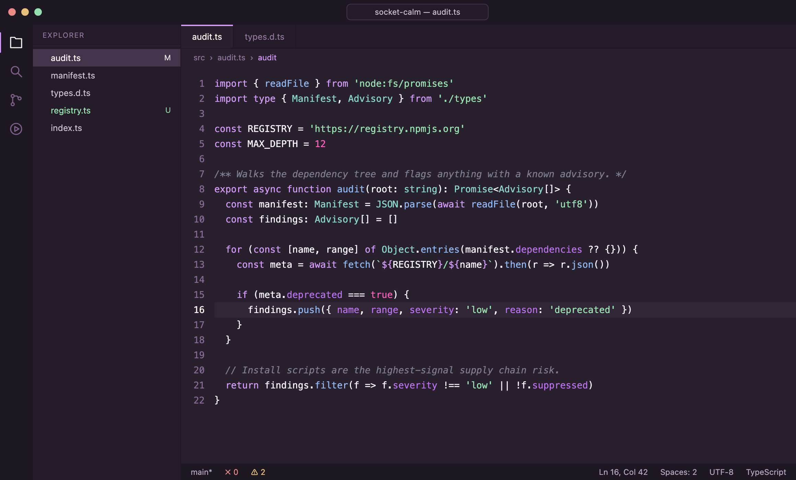
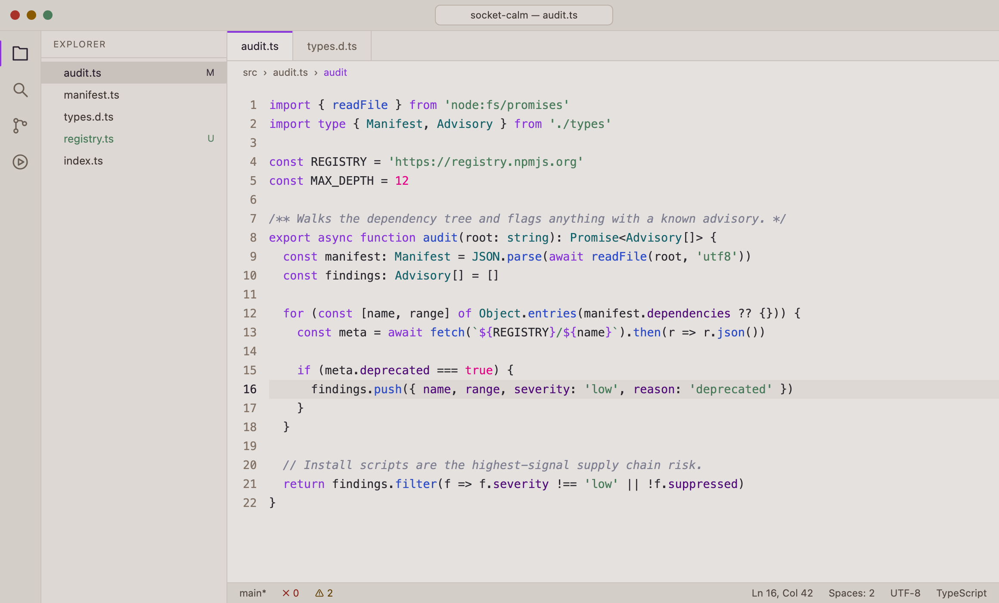

# Socket Calm

A low-noise syntax theme in warm plum and sand. Six colors do the work, and nothing shouts.

Most themes assign a color to every grammar rule they can find. Socket Calm goes the other
way: operators, punctuation, and variables stay in the foreground color, so the things that
actually carry meaning — keywords, calls, strings, keys, literals — are the only things that
change hue. Both variants are lifted directly from Socket's design system.

It ships as two things from this one repo: a **VS Code extension** and a **Vim / Neovim
colorscheme**. Install whichever you need — see [VS Code](#install-in-vs-code) or
[Vim / Neovim](#install-in-vim--neovim) below.

## Socket Calm Dark



## Socket Calm Light



## Install in VS Code

From the Extensions view (`⇧⌘X` / `Ctrl+Shift+X`), search for **Socket Calm** and click
Install. Then pick a variant with `⌘K ⌘T` / `Ctrl+K Ctrl+T`:

- **Socket Calm Dark**
- **Socket Calm Light**

Or from the command line:

```bash
code --install-extension SocketSecurity.socket-calm
```

## Install in Vim / Neovim

No VS Code needed — the same theme ships as a standalone Vim colorscheme in
[vim/colors/socket-calm.vim](vim/colors/socket-calm.vim), one file covering both variants,
true-color and 256-color terminals, Vim 8+ and Neovim (including Treesitter, LSP semantic
tokens, diagnostics, and terminal ANSI colors).

**Manually** — copy the file into your colors directory:

```bash
mkdir -p ~/.vim/colors && curl -fLo ~/.vim/colors/socket-calm.vim https://raw.githubusercontent.com/SocketDev/socket-calm/main/vim/colors/socket-calm.vim
```

For Neovim, use `~/.config/nvim/colors/` instead of `~/.vim/colors/`.

**With a plugin manager** — point it at this repo and set the runtime path to the `vim/`
subdirectory:

```vim
" vim-plug
Plug 'SocketDev/socket-calm', { 'rtp': 'vim' }
```

```lua
-- lazy.nvim
{ "SocketDev/socket-calm", lazy = false, priority = 1000,
  config = function(plugin) vim.opt.rtp:append(plugin.dir .. "/vim") end }
```

### Use

Typing `:colorscheme socket-calm` works, but only for that session. To make it stick, put it in
your config file — `~/.vimrc` for Vim, `~/.config/nvim/init.lua` for Neovim. Neither file exists
on a fresh install; create it if it isn't there.

```vim
" ~/.vimrc
syntax enable
set termguicolors        " true color; without it the theme falls back to 256 colors
set background=dark      " Socket Calm Dark — or 'light' for Socket Calm Light
silent! colorscheme socket-calm
```

```lua
-- ~/.config/nvim/init.lua
vim.opt.termguicolors = true
vim.opt.background = "dark"   -- or "light"
vim.cmd.colorscheme("socket-calm")
```

Set `background` *before* `colorscheme` — the colorscheme reads it to decide which variant to
build. The `silent!` is optional and just keeps Vim starting cleanly if the colorscheme file ever
goes missing, instead of raising `E185` on every launch.

Switching `set background=light` ⇄ `set background=dark` after loading swaps variants on the
spot. Comments are italic by default; to disable that (e.g. for terminals without italics),
set this before loading:

```vim
let g:socket_calm_italics = 0
```

Inside tmux or screen, Vim can't infer true-color support from termcap, so `termguicolors` alone
silently leaves you on the 256-color fallback. Add these above it:

```vim
let &t_8f = "\<Esc>[38;2;%lu;%lu;%lum"
let &t_8b = "\<Esc>[48;2;%lu;%lu;%lum"
```

Neovim handles this itself and doesn't need them.

### Derived accents

Not used for syntax — only diagnostics, git decorations, diffs, and terminal ANSI.

- Error
- Warning
- Escapes, regex, macros

## Recommended settings

Nothing here is required — the theme stands on its own — but this is what the previews use:

```jsonc
{
  "editor.semanticHighlighting.enabled": true,
  "editor.bracketPairColorization.enabled": true,
  "editor.guides.bracketPairs": "active",
  "editor.renderLineHighlight": "all",
  "editor.cursorBlinking": "smooth"
}
```

Semantic highlighting is on by default in both variants and is what makes types, default-library
symbols, and enum members resolve correctly in TypeScript, Python, Rust, and Go.

## Development

```bash
pnpm install
pnpm run validate    # JSON, color ids, duplicate keys, contrast
pnpm run previews    # regenerate README screenshots (needs Google Chrome)
pnpm run package     # build socket-calm-<version>.vsix
```

The previews are generated from the theme JSON rather than screenshotted by hand, so the
images in this README can't drift from the actual colors.

## License

MIT — see [LICENSE](LICENSE).

